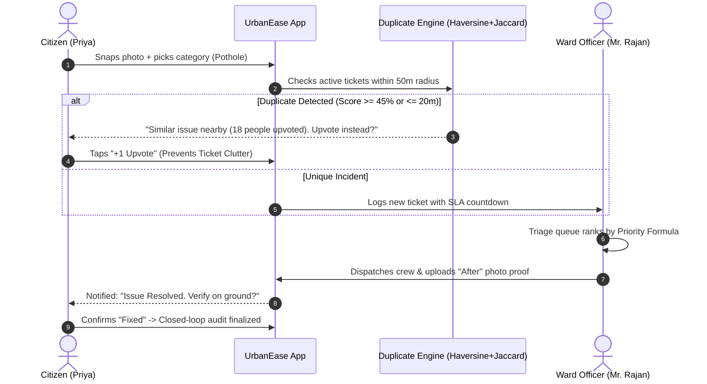

# UrbanEase: Presentation Deck & Working Architecture
> **Theme:** Smart City & Sustainable Mobility  
> **Tagline:** "Smarter City. Easier Life. Simplifying Cities, Empowering Communities."  
> **Target Prototype City:** Coimbatore, Tamil Nadu  

---

## Slide 1: Title Slide
- **Title:** **UrbanEase (அர்பன்ஈஸ்)**
- **Subtitle:** Next-Generation Civic Infrastructure, Smart Parking, and Crowdsourced Transit Platform
- **Problem Statement (Theme 5):** Smart City & Sustainability
- **Target Audience:** Citizens (Commuters & Residents), Ward Officers (Public Works), City Mobility Planners
- **Presenter Team:** UrbanEase Hackathon Team

---

## Slide 2: The Core Problem & Hackathon Context
### Why Existing Civic Systems Fail
1. **The Complaint Black Hole:** Citizens report potholes or sewage leaks on social media or municipal web portals, but reports sit unaddressed without clear SLAs, live audit trails, or proof of resolution.
2. **Ticket Spam & Clutter:** 30 people report the exact same pothole at the same intersection, generating 30 redundant tickets that overwhelm municipal ward triage queues.
3. **Mobility Disconnect:**
   - Commuters circle crowded zones searching for parking, increasing carbon emissions and idle traffic congestion.
   - EV drivers face **"charger anxiety"**: unaware whether a charging gun is occupied, operational, or out of order.
   - Public bus commuters cannot verify real-world traffic delays before leaving home.

---

## Slide 3: Our Solution — 3 Integrated Pillars
```
┌────────────────────────────────────────────────────────────────────────┐
│                               URBANEASE                                │
├──────────────────────────┬───────────────────────┬─────────────────────┤
│   1. CIVIC HAZARD HERO   │   2. PARK & CHARGE    │  3. TRANSIT FLEET   │
│   • 3-Tap Geotag Report  │   • Live Deck Slots   │  • Crowdsourced GPS │
│   • 50m Duplicate Check  │   • EV Health Monitor │  • Live Delay Alerts│
│   • SLA Escalation Clock │   • Offline QR Pass   │  • Occupancy Level  │
│   • Before/After Proof   │   • Barrier Simulator │  • Multimodal Hub   │
└──────────────────────────┴───────────────────────┴─────────────────────┘
```
- **Cross-Cutting Enablers:**
  - **Closed-Loop Citizen Audit**: A ticket cannot be closed without before/after photos and citizen confirmation.
  - **Bilingual Interface**: Seamless 1-click toggle between English and **தமிழ் (Tamil)**.
  - **Green Impact Score**: Gamified citizen rewards for public transit and EV adoption.

---

## Slide 4: Hero Flow — Civic Issue Lifecycle & Duplicate Detection
### How a Ticket Moves from Ground to Resolution


---

## Slide 5: The Math & Algorithms Under the Hood
UrbanEase replaces guesswork with real, measurable algorithms:

### 1. Spatial & Textual Duplicate Detection
- **Haversine Great-Circle Distance ($d$):**
  $$d = 2R \cdot \arcsin\left(\sqrt{\sin^2\left(\frac{\Delta\phi}{2}\right) + \cos(\phi_1)\cos(\phi_2)\sin^2\left(\frac{\Delta\lambda}{2}\right)}\right)$$
- **Jaccard Token Keyword Overlap ($J$):**
  $$J(A, B) = \frac{|A \cap B|}{|A \cup B|}$$
- If distance $\le 50\text{m}$ and $J(A,B)$ meets threshold, the issue triggers a duplicate warning and aggregates community upvotes.

### 2. Transparent Civic Priority Ranking Score (0–100)
$$\text{Priority} = f(\text{Severity: } 10\text{–}40) + f(\text{Upvotes: up to } 30) + f(\text{Category: } 10\text{–}25) + f(\text{Aging: } 2\text{ pts/6h}) + f(\text{School/Hospital Zone: } +15)$$

### 3. Offline-Verifiable Tamper-Proof QR Pass
- Uses deterministic **djb2 hash signatures** encoded in base64:
  $$\text{Hash} = \sum (\text{hash} \times 33) \oplus \text{char}$$
- Barrier gate scanners verify authenticity locally in underground basements without requiring active internet connectivity.

---

## Slide 6: Module 1 — Smart Park & EV Charging Hub
### Solving Urban Parking Congestion & Range Anxiety
1. **Live Deck Monitoring:** Real-time occupancy tracking across 12 Coimbatore multi-level and surface facilities (Gandhipuram, RS Puram, Peelamedu, Railway Junction).
2. **Visual Space Selector:** Interactive slot grid allowing citizens to choose standard, compact, or EV-equipped bays.
3. **EV Network Health Matrix:**
   - Real-time diagnostic ledger showing **Working**, **Charging**, and **Faulty / Down** dispenser guns.
   - Multi-standard support: CCS2 (up to 120kW Rapid DC), Type 2 AC (22kW), CHAdeMO, and 3-pin slow plugs.
   - Built-in fault simulation: Allows municipal operators to toggle gun health and dispatch maintenance crews.
4. **Instant Digital QR Pass:** Offline entry pass complete with barrier gate simulator validating cryptographic authenticity.

---

## Slide 7: Module 2 — Crowdsourced Public Bus Tracking
### Real-Time Fleet Intelligence Powered by Commuters
- **Commuter GPS Telemetry:** Passengers tap **"I'm on this bus"** to anonymously broadcast live position and speed without expensive proprietary hardware.
- **Schedule vs. Reality Delay Engine:** Compares actual stop timestamps against scheduled timetables to display exact delay indicators (`+8m Late`, `On Time`).
- **Crowd Congestion Indicator:** Badges bus capacity as *Seats Available*, *Standing Room*, or *Overcrowded* using passenger feedback.
- **Route Corridors:** Pre-configured for Coimbatore arterials:
  - Route 70: Gandhipuram ⇄ Saravanampatti IT SEZ
  - Route 11: Railway Junction ⇄ Peelamedu ⇄ Airport
  - Route 3: Ukkadam ⇄ RS Puram ⇄ Saibaba Colony
  - Route 1C, 90A, 76

---

## Slide 8: Officer Operations Desk & Planner Matrix
### Turning Reports into Streamlined Field Operations
- **Officer Triage Console (Mr. Rajan):**
  - KPI Dashboard: Total open tickets, SLA countdowns, active breaches, and average turnaround time.
  - Actionable workflow stepper: *Reported* → *Verified* → *Dispatched* → *Resolved*.
  - Government mandatory photo-proof verification: Workers must upload before/after photos before an SLA clock can stop.
  - 1-click **CSV Audit Export** for municipal records.
- **City Planner Matrix (Dr. Anita):**
  - **Hotspot Optimization AI:** Identifies clusters of defects within 300m and automatically recommends consolidated asphalt contractor dispatch, saving public funds in heavy machinery mobilization.
  - Ward infrastructure stress bar charts and category distribution pie analytics.

---

## Slide 9: Technical Architecture & Offline Resilience
```
┌────────────────────────────────────────────────────────┐
│                   PRESENTATION TIER                    │
│   React 19 + TypeScript + Vite + Tailwind CSS v4      │
│   Responsive Desktop Website + 390px Mobile Mode       │
├────────────────────────────────────────────────────────┤
│                    DOMAIN SERVICES                     │
│   • Haversine & Jaccard Engine   • djb2 Cryptography   │
│   • SLA Countdown Calculators    • Smart AI Classifier │
├────────────────────────────────────────────────────────┤
│                   LOCAL REPOSITORY                     │
│   • Seeded Coimbatore Ledger (42 Issues, 15 Stations)  │
│   • Zero-Failure Offline Fallback (LocalStorage / IDB) │
│   • Swappable Supabase / Firebase / Node REST Schema   │
└────────────────────────────────────────────────────────┘
```
- **Zero Paid APIs Required:** Uses OpenStreetMap tiles and client-side algorithms with no billing limits.
- **Deployment:** Live on GitHub Pages with relative routing and 404 fallbacks.

---

## Slide 10: Business Model & Scalability Roadmap
### Sustainability & Monetization (B2G + B2B)
- **For Citizens:** 100% Free public service app.
- **Municipal Corporations (B2G SaaS):** Annual subscription for the Officer Dispatch Desk, SLA compliance reports, and Planner Analytics suite.
- **Parking Facility Operators (B2B):** 2.5% convenience micro-fee on automated slot reservations.
- **EV Charging Networks:** Discovery commissions and affiliate listings with charging providers (Zeon, Kazam, Tata Power).

### Future Roadmap
1. WhatsApp Bot integration for reporting without installing the app.
2. Direct edge ML computer vision model running on mobile cameras to measure pothole depth automatically.
3. Automated integration with municipal TANGEDCO power grid telematics.

---

## 🎙️ Speaker Pitch Notes (3-Minute Script)
- **0:00 - 0:45:** Introduce UrbanEase. Show Priya reporting a pothole. Demonstrate the Haversine + Jaccard duplicate detector preventing a 15th duplicate ticket.
- **0:45 - 1:30:** Switch to Officer Rajan. Demonstrate the priority score formula, the SLA timer, and upload of photo proof. Show Priya verifying the fix.
- **1:30 - 2:15:** Switch to Karthik booking parking and a CCS2 charger. Show the EV health monitor detecting faulty guns, followed by the QR pass barrier scan.
- **2:15 - 3:00:** Show the Planner Matrix saving ₹42,000 via cluster repair dispatch, summarize the B2G monetization model, and open for judge questions.
